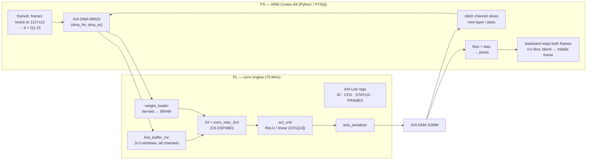

# Video Frame Interpolation on a PYNQ-Z2 FPGA

An FPGA accelerator that doubles a video's frame rate. A 6-layer convolutional network on the
Zynq-7020's programmable logic estimates optical flow between two frames. The ARM side then warps
both frames to the midpoint and blends them into the missing frame.

The conv engine is written from scratch in SystemVerilog: line-buffered, streaming, with AXI-Stream
and AXI-DMA throughout. **On real silicon its output matches a bit-exact software reference at every
layer** (0 mismatches over the full network), and the end-to-end video pipeline runs on the board.

> **Status (Nov 2026).** The hardware is done and verified. The model is the open item: the
> deployed weights were trained on Moving-MNIST only, so on real video they lose to a plain 50/50
> blend of the two frames. Training on real footage is next. See [Status and roadmap](#status-and-roadmap).

---

## How it works



- **Input:** frame0 RGB and frame1 RGB stacked into one 112×112×6 tensor in Q1.15 fixed point.
- **Network:** six 3×3 conv layers, `6 → 32 → 64 → 128 → 64 → 32 → 2`. conv1–conv5 use ReLU. The
  flow layer is linear, so the flow can be negative (leftward or upward motion); one runtime
  register bit, CFG[14], turns ReLU off for it.
- **Execution:** one bitstream runs every layer. Channel count, requantisation shift and activation
  are runtime registers. The engine produces 24 output channels per pass, so a layer with more
  outputs runs in ⌈C_out / 24⌉ passes. Feature maps go to and from DDR over AXI-DMA, 17 passes per
  frame pair.
- **Output:** a 2-channel flow field (dx, dy). The PS adds the flow bias, scales the flow to the
  output resolution, and does a bilinear backward warp of each frame by ±½·flow before blending.

## Results on hardware (PYNQ-Z2, 2026-11-02)

### Correctness: bit-exact at every layer

| Layer | in → out | Activation | Passes | Mismatches vs golden |
|---|---|---|---|---|
| conv1 | 6 → 32 | ReLU | 2 | 0 |
| conv2 | 32 → 64 | ReLU | 3 | 0 |
| conv3 | 64 → 128 | ReLU | 6 | 0 |
| conv4 | 128 → 64 | ReLU | 3 | 0 |
| conv5 | 64 → 32 | ReLU | 2 | 0 |
| flow | 32 → 2 | linear | 1 | 0 |

The flow the board returned equals the golden dump exactly, and includes 789 negative values. That
confirms the linear flow layer on silicon. Bring-up also passed all six staged checks: register
access, kernel DMA, a 150 KB in / 602 KB out feature-map round trip, and 301,056 values bit-exact.

### Performance

| | |
|---|---|
| Full network, 112×112 | **~912–937 ms per frame pair → 1.07–1.10 interpolated frames/s** |
| PL compute floor | 179 ms per frame pair (at the design clock) |
| Where the rest goes | ~81% PS-side: DMA setup, buffer handling, stitching channel slices |
| End-to-end demo, 1280×720 | 2.62 s per pair (1.10 s flow + ~1.5 s host resize/warp/blend) |

The PL is not the bottleneck: one conv1 pass takes 21.4 ms on the wall clock against a 1.0 ms
compute floor. Cutting host overhead is the clearest route to more fps.

### Implementation (Vivado 2025.1, `xc7z020clg400-1`, post-route)

| Resource | Used | Available | Utilisation |
|---|---|---|---|
| DSP48E1 | 216 | 220 | **98%** |
| Block RAM (36 Kb) | 67 | 140 | 48% |
| Slice LUTs | 20,956 | 53,200 | 39% |
| Slice registers | 24,182 | 106,400 | 23% |

Timing closes at **75 MHz**: WNS +0.014 ns, WHS +0.029 ns, 0 failing endpoints. At 100 MHz the
critical path missed by 2.8 ns post-route, even though out-of-context synthesis showed +1.1 ns. The
path is mostly routing (82%): the 144-bit window broadcast to 24 MACs spread across the die.

## Engineering notes

A few things this project taught, the hard way:

- **Vivado will build a design that computes nothing and report success.** The first version of
  this project synthesised to 67 LUTs and 0 BRAM, because a tied-off weight port made the whole
  datapath constant zero and Vivado optimised it away. Every cause was a *warning* (width mismatch,
  unconnected port). The build now promotes `Synth 8-689` and `8-7023` to errors, and every RTL
  change is linted with Verilator.
- **Verify against a bit-exact reference, not "close enough".** `model/vfi_ref.py` (numpy only)
  reproduces the RTL's integer arithmetic exactly: rounding, saturation at accumulator width, Q1.15
  narrowing. It is itself checked against a from-the-definition implementation. Every layer is then
  diffed in simulation and on the board.
- **Test blocks composed, not only alone.** Each block has a unit testbench, but integration
  testbenches chain them (up to the whole network) with backpressure stalls on both AXI sides,
  plus `axis_checker.sv` watching for protocol violations.
- **Read the IP parameters.** The AXI-DMA's default 14-bit length register caps a transfer at
  16 KB. The first bitstream would have passed the kernel load and hung on the first feature map.
  No simulation catches this; reading the generated `.hwh` against the driver's transfer sizes did.
- **Only post-route timing counts.** See the 100 MHz numbers above.

## Repository layout

```
rtl/conv/     streaming conv engine: line buffers, 3x3 MAC, activation, serializer, layer
rtl/axis/     AXI-Stream / AXI-Lite: skid buffer, weight loader, registers, vfi_top
sim/          testbenches (xsim), axis_checker, run_xsim.ps1 / run_lint.ps1
syn/          build.tcl (project + block design + bitstream), PS7 config, OOC scripts
model/        bit-exact numpy reference model and golden-dump generators
host/         PYNQ driver, staged bring-up, board tests, perf, demo, board-kit builder
train/        PyTorch training matched to the hardware, Q1.15 export, real-video clip picker
docs/         design handoff (PROJECT_CONTEXT.md) and the bring-up log (STATUS.md)
```

The earlier spike-routing design that the conv engine replaced lives in the git tag
[`legacy-spike-design`](../../tree/legacy-spike-design).

## Running it

**Reference model and host tests** (Python 3 + numpy; no board, no torch):

```bash
python model/test_vfi_ref.py
python host/test_vfi_driver.py
python host/test_bringup.py        # bring-up script against a mock PL, incl. fault injection
```

**RTL simulation and lint** (Vivado 2025.1 xsim, Verilator; PowerShell):

```powershell
.\sim\run_lint.ps1
.\sim\run_xsim.ps1 -Tb tb_line_buffer_3x3 -Sources rtl\conv\line_buffer_3x3.sv
```

`sim/tb_network_golden.sv` runs the whole network against the trained model's golden dumps. Its
header lists the sources it needs.

**Bitstream:**

```powershell
vivado -mode batch -source syn\build.tcl
```

**On the board:** `host/make_kit.py` packages the bitstream, driver, model export and scripts.
`host/BOARD_STEPS.md` gives the run order: `bringup.py → conv1_board.py → network_board.py →
perf.py → demo.py`.

## Status and roadmap

Done:
- Conv engine RTL, AXI-Stream/DMA path, bitstream at 75 MHz
- Bit-exact verification: unit, integration, whole network in xsim, and on the board
- End-to-end video pipeline on the board
- Training and export pipeline matched to the hardware (no conv biases, Q1.15 activations, linear flow layer)

Next:
1. **Train on real video.** The current model was trained on Moving-MNIST (21.5 dB vs 14.9 dB
   for the blend there) and invents motion on real footage.
2. **Cut PS-side overhead** (~81% of wall time): fewer copies, batched DMA descriptors, overlapping
   transfer with compute.
3. Pipeline the window broadcast to get back toward 100 MHz.
4. Demo video on a clip with real motion: original vs interpolated, against the blend baseline.
5. Later, a **spiking (LIF) version** on the same hardware. Only the activation unit changes,
   plus a timestep loop. It will be compared on accuracy, throughput and measured power.

## Authors

PL side (RTL, AXI/DMA, verification): Manas. PS side (model training, host software): collaborator.
